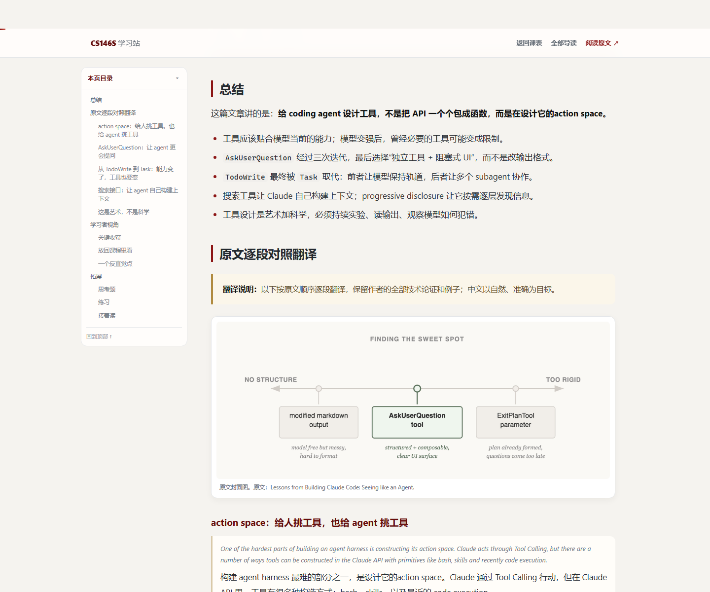

**[👉 打开在线学习站](https://liuw.tech/CS146S_CN_study/)** · [⭐ Star 这个仓库](https://github.com/sysuleo/CS146S_CN_study)

<div align="center">

# CS146S 中文精读站

**把一门关于 AI 原生软件开发的课，整理成可以逐段对照、反复复盘的中文学习站。**

课程原名：Stanford CS146S: The Modern Software Developer · Fall 2026

非官方中文学习站 · 官网内容同步于 2026-11-19

</div>


> 本项目不隶属于 Stanford，也不代表课程团队。课程原文、讲稿、PPT 与图片的版权归原作者或原机构所有；本仓库只整理个人学习所需的翻译、注释与阅读工具。详见 [NOTICE.md](NOTICE.md)。

## 打开就能开始

CS146S 的材料分散在官网、博客、论文、产品文档、Slides、transcript 和视频里。只收集链接的话，复习时仍然要在十几个标签页之间来回切。

这里把同一周的材料收进一个中文站点，每篇固定按「总结 → 原文逐段对照 → 学习者视角 → 延伸练习」组织：

| 你想做的事 | 点这里 |
|---|---|
| 按周看主题、阅读、Slides 和视频 | [**课程表**](https://liuw.tech/CS146S_CN_study/schedule.html)：打开站点就是这一页 |
| 挑一篇中译开始读 | [**学习资料索引**](https://liuw.tech/CS146S_CN_study/study/)：28 篇，按周分组，标注时长与类型 |
| 先看一篇长文感受一下 | [深入 Claude Code：生产级 Agent 的设计空间](https://liuw.tech/CS146S_CN_study/study/w1-dive-into-claude-code.html)（45 min） |
| 看课堂实录与逐页 PPT | [生产级 Coding Agent 的 Harness 解剖（9/24）](https://liuw.tech/CS146S_CN_study/study/w1-lecture-9-24-transcript.html)（20 min） |

不需要注册、不需要部署，浏览器打开就能读。

## 这里有什么

| 模块 | 内容 |
|---|---|
| 课程表 | 按周整理主题、阅读、课堂安排、Slides、transcript、嘉宾与视频链接，并回链到对应学习页 |
| 学习页 | 28 个页面，每页固定包含「总结 / 原文逐段对照翻译 / 学习者视角 / 拓展」 |
| 课堂资料 | 3 篇课堂实录按讲课顺序整理；52 张 PPT 按讲稿段落逐页插入 |
| 原文图表 | 107 个本地图片（含多格式兼容副本），按原文 H2/H3 原位保留 |
| 阅读体验 | 左侧粘性目录、滚动高亮、窄屏折叠，不依赖前端框架 |

页面结构、本地链接、PPT 数量和缺失图片都有脚本可复核（`make check`），不是靠人工点开的清单。

## 这个项目的优势

- **学习深度**：不是给你一堆链接，而是把每篇拆成「总结 / 逐段对照 / 学习者视角 / 延伸练习」，读完能落到自己的项目里。
- **原文可追溯**：原文的 H2/H3 标题、图表位置、PPT 页码都保留着，读到任何一句都能回查出处。
- **边界写得清楚**：哪些完成了、哪些还没做、哪些是原创整理、哪些版权属于原作者，都在 [内容进度](#内容进度) 和 [NOTICE.md](NOTICE.md) 里写明，不拿“链接存在”当“内容已交付”。
- **工具链自洽**：内容源、构建、检查、发布都在同一个仓库里，改一篇 Markdown 就能重建整站，并有脚本核对链接与资源数量。

### 翻译与整理原则

目标不是“把英文换成中文”，而是保留原文的技术论证，同时让中文读者读得下去：

- **准确优先于流畅，流畅优先于简洁**：不省略论证、数据和限制条件。
- **按段落对照**：不按单词硬切，也不把总结混进翻译。
- **难译术语保留英文**：例如 `action space`、`harness`、`context window`、`compaction`、`subagent`、`tool call`、`spec`。
- **原文结构不重排**：总结、学习者视角和拓展只能放在原文主体之前或之后。
- **图表回到原位置**：不把图集中堆到页首或页尾。
- **PPT 一页一行**：通过显式页面锚点匹配讲稿，不靠相似度猜测。

完整约定见 [RULES.md](RULES.md)。

## 页面预览

| 首页 | 原文逐段对照 |
|---|---|
|  |  |

课程表：


## 内容进度

项目坚持把“已经完成”和“尚未完成”写清楚，避免把链接存在误认为内容已经交付。

| 项目 | 当前状态 |
|---|---|
| Fall 2026 课表 | 已按 2026-11-19 官网同步，包括 Week 8–10 的阅读、Slides 与嘉宾变更 |
| 学习页 | 28 个页面均已精修 |
| 阅读材料 | 25 篇已中译；Week 8/9 新增的 8 篇已全部补齐 |
| 课堂实录 | 9/24、9/29、10/1 三篇已整理并插入 PPT |
| 课堂 PPT | 52 页，9/24 17 页、9/29 18 页、10/1 17 页，图片缺失 0 |
| 原文图表 | 已下载到本地并按原文章节回填 |
| 视频 | 3 个视频链接；不做逐字转写或字幕翻译 |
| 作业 | 当前不收录课程作业或作业答案 |
| Fall 2025 | 仅提供官网归档入口，不复制整套旧课程 |

已知边界：

- *Dive into Claude Code* 采用章节级精译，覆盖全部章节；参考文献与附录从略。
- 课堂实录覆盖技术讲授与技术问答；寒暄、重复表述和无法辨认的现场互动从略。
- 产品文档的超长目录、兼容性名单可概括处理，但会在页内注明。
- 2026 年秋季课程仍在进行，后续官网更新需要重新同步。

## 本地运行与二次构建

**只是想读，上面三个链接就够了。** 需要自己跑一份或改内容时：

```bash
make build   # 由 content/study_src 重建学习页
make check   # 检查本地链接与资源数量
```

venv / Docker / systemd / Nginx / 运维接口 / 端口配置见 [docs/DEPLOY.md](docs/DEPLOY.md)；静态托管与自定义域名见 [docs/PUBLISH.md](docs/PUBLISH.md)。

<details>
<summary>项目结构</summary>

```text
.
├─ app/
│  ├─ server.py              # FastAPI：静态站、构建任务、重启接口
│  └─ static/
│     ├─ index.html          # 站点根入口，跳转到 schedule.html
│     ├─ schedule.html       # 课程表
│     ├─ admin.html          # 运维面板
│     └─ study/              # 28 个学习页 + 图片 / PPT 资源
├─ content/
│  ├─ study_src/             # 学习页 Markdown 源文件
│  └─ schedule.md            # 课程表 Markdown
├─ data/
│  └─ syllabus2026.json      # 官网 Syllabus 结构化数据
├─ tools/
│  ├─ build.py               # 生成学习页并回链课表
│  ├─ slides.py              # 逐页锚点插入 PPT
│  ├─ check.py               # 链接、结构与资源检查
│  └─ sync_syllabus.py       # 同步官网 Syllabus
├─ docs/
│  ├─ ARCHITECTURE.md        # 构建链与目录说明
│  ├─ DEPLOY.md              # 本地运行 / Linux / systemd / Docker / Nginx
│  ├─ PUBLISH.md             # GitHub Pages 静态发布
│  └─ images/                # README 页面截图
├─ .github/workflows/        # 推送后自动发布静态站
├─ .local/                   # 原始抓取、缓存、任务日志（不提交）
├─ Dockerfile
├─ docker-compose.yml
├─ Makefile
├─ start.sh / stop.sh / restart.sh / start.ps1
├─ RULES.md                  # 翻译、图表、PPT、构建规则
├─ NOTICE.md                 # 第三方内容与版权边界
└─ README.md
```

</details>

## 许可证与版权边界

本仓库包含 [MIT LICENSE](LICENSE)。没有许可证时默认是“保留所有权利”，别人即使能看见代码，也不能放心复制或再发布；MIT 允许使用、修改、分发和商用本项目**有权许可的部分**，同时要求保留版权与许可声明。

MIT 覆盖 `app/`、`tools/` 中的代码与构建脚本、站点样式与交互实现，以及本项目独立撰写的总结、导读、学习者视角和拓展内容。

**不覆盖**课程原文、课堂讲稿、PPT、原文图片及第三方仓库内容——这些权利仍归各自作者或机构所有。若你是权利方并希望调整或移除某份材料，请通过仓库维护者联系处理。以上是项目层面的说明，不构成法律意见。

## 来源与致谢

- 课程官网：<https://themodernsoftware.dev/>
- Fall 2025 归档：<https://themodernsoftware.dev/fall2025>
- 课程阅读、讲稿、PPT 与图片：归原作者与原机构所有

---

**觉得有用就点个 ⭐ [Star](https://github.com/sysuleo/CS146S_CN_study)。** 没有广告、没有付费墙，Star 是这个项目最直接的反馈；发现错译或失效链接，欢迎按 [RULES.md](RULES.md) 提修订。
