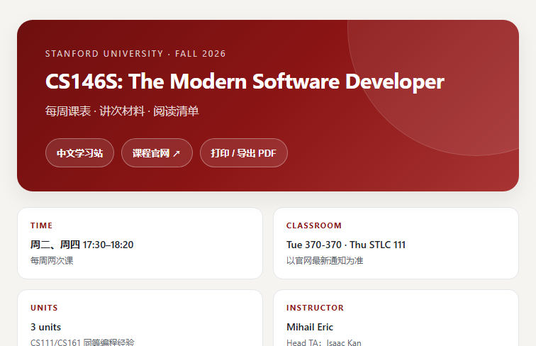

<div align="center">

# CS146S 中文精读站

**把一门关于 AI 原生软件开发的课，整理成可以逐段对照、反复复盘、直接部署的学习系统。**

Stanford CS146S: The Modern Software Developer · Fall 2026

非官方学习项目 · 官网内容同步于 2026-11-19

[快速起服](#快速起服) · [课程表](app/static/schedule.html) · [GitHub Pages](docs/PUBLISH.md) · [学习规则](RULES.md) · [部署文档](docs/DEPLOY.md) · [后续事项](TODO.md)

</div>


> 本项目不隶属于 Stanford，也不代表课程团队。课程原文、讲稿、PPT 与图片的版权归原作者或原机构所有；本仓库只整理个人学习所需的翻译、注释与阅读工具。详见 [NOTICE.md](NOTICE.md)。

## 页面预览

| 首页 | 原文逐段对照 |
|---|---|
|  |  |

课程表：



## 这不是一个链接合集

CS146S 的材料更新快、来源分散：官网负责课程安排，阅读分布在博客、论文、产品文档和 GitHub，课堂内容又分别落在 Slides、transcript 和视频里。只收集链接，复习时仍然要在十几个标签页之间来回切换。

这个项目把同一周的材料收进一个可部署的学习站，并为每篇材料建立固定的学习闭环：

1. **先看总结**：用几分钟建立问题意识和论证主线。
2. **再读原文对照**：英文段落与中文段落交替出现，随时回到原文核对。
3. **进入学习者视角**：把文章放回课程脉络，指出真正可迁移的做法和容易误解的地方。
4. **最后做拓展**：用思考题、练习和延伸阅读把“看懂”变成“会用”。

因此，它更适合“认真学一遍并留下可复习资料”的场景，而不是替代课程官网或作业说明。

## 你会得到什么

| 模块 | 内容 |
|---|---|
| 课程表 | 按周整理主题、阅读、课堂安排、Slides、transcript、嘉宾与视频链接，并回链到对应学习页 |
| 学习页 | 28 个页面，每页固定包含“总结 / 原文逐段对照翻译 / 学习者视角 / 拓展” |
| 课堂资料 | 3 篇课堂实录，正文按讲课顺序整理；52 张 PPT 按讲稿段落逐页插入 |
| 原文图表 | 107 个本地图片文件（含多格式兼容副本），按原文 H2/H3 原位保留 |
| 阅读体验 | 左侧粘性目录、滚动高亮、窄屏折叠；页面不依赖前端框架 |
| 部署与运维 | FastAPI 静态站、构建任务 API、`/admin` 面板、Docker 与 systemd 方案 |
| 质量检查 | 本地链接、页面结构、PPT 数量和缺失图片均有脚本可复核 |

### 翻译与整理原则

项目的目标不是“把英文换成中文”，而是保留原文的技术论证，同时让中文读者读得下去：

- **准确优先于流畅，流畅优先于简洁**：不省略论证、数据和限制条件。
- **按段落对照**：不按单词硬切，也不把总结混进翻译。
- **难译术语保留英文**：例如 `action space`、`harness`、`context window`、`compaction`、`subagent`、`tool call`、`spec`。
- **原文结构不重排**：总结、学习者视角和拓展只能放在原文主体之前或之后。
- **图表回到原位置**：不把图集中堆到页首或页尾。
- **PPT 一页一行**：通过显式页面锚点匹配讲稿，不靠相似度猜测。

完整约定见 [RULES.md](RULES.md)。

## 在线托管（GitHub Pages）

**读者访问不需要服务器。** 课程表和学习页都是静态 HTML，已经附带 GitHub Pages 工作流：

```text
.github/workflows/pages.yml
```

一次性配置：

1. 推送到 GitHub，默认分支使用 `main` 或 `master`。
2. 仓库 **Settings → Pages → Build and deployment → Source** 选择 **GitHub Actions**。
3. 推送代码，或手动运行 **Deploy static study site**。

发布地址：

```text
https://<用户名>.github.io/<仓库名>/
```

GitHub Pages 会发布 `app/static` 的静态内容：课程表、学习页、PPT 和图表。**不会提供** `/admin`、`/api/jobs`、`/api/restart` 或本地端口配置；这些能力只在自托管服务中存在。完整步骤见 [docs/PUBLISH.md](docs/PUBLISH.md)。

## 快速起服

### Linux / macOS

```bash
python3 -m venv .venv
. .venv/bin/activate
pip install -r requirements.txt

cp .env.example .env
chmod +x start.sh stop.sh restart.sh
./start.sh
```

`start.sh` 默认在后台启动，日志写入 `.local/server.log`，PID 写入 `.local/server.pid`。停止服务用 `./stop.sh`，重启用 `./restart.sh`；需要前台调试时用 `FOREGROUND=1 ./start.sh`。

### Windows PowerShell

```powershell
python -m venv .venv
.\.venv\Scripts\Activate.ps1
pip install -r requirements.txt

Copy-Item .env.example .env
.\start.ps1
```

### Docker

```bash
cp .env.example .env
docker compose up --build -d
```

默认地址：

- 学习站：<http://127.0.0.1:8787/>
- 课程表：<http://127.0.0.1:8787/schedule>
- 运维面板：<http://127.0.0.1:8787/admin>
- 健康检查：<http://127.0.0.1:8787/api/health>

### 修改端口

端口只在一个地方配置：

```bash
# .env
HOST=0.0.0.0
PORT=9000
```

```bash
./restart.sh
# 或
docker compose up --build -d
```

`PORT` 同时控制服务监听端口和 Docker 宿主机映射端口。Nginx、systemd 与防火墙配置见 [docs/DEPLOY.md](docs/DEPLOY.md)。

## 内容进度

项目坚持把“已经完成”和“尚未完成”写清楚，避免把链接存在误认为内容已经交付。

| 项目 | 当前状态 |
|---|---|
| Fall 2026 课表 | 已按 2026-11-19 官网同步，包括 Week 8–10 的阅读、Slides 与嘉宾变更 |
| 学习页 | 28 个页面均已精修 |
| 阅读材料 | 25 篇已中译；Week 8/9 新增的 8 篇已全部补齐 |
| 课堂实录 | 9/24、9/29、10/1 三篇已整理并插入 PPT |
| 课堂 PPT | 52 页，9/24 17 页、9/29 18 页、10/1 17 页，图片缺失 0 |
| 原文图表 | 已下载到本地并按原文章节回填 |
| 视频 | 3 个视频链接；不做逐字转写或字幕翻译 |
| 作业 | 当前不收录课程作业或作业答案 |
| Fall 2025 | 仅提供官网归档入口，不复制整套旧课程 |

已知边界：

- *Dive into Claude Code* 采用章节级精译，覆盖全部章节；参考文献与附录从略。
- 课堂实录覆盖技术讲授与技术问答；寒暄、重复表述和无法辨认的现场互动从略。
- 产品文档的超长目录、兼容性名单可概括处理，但会在页内注明。
- 2026 年秋季课程仍在进行，后续官网更新需要重新同步。

## 构建与验收

### 标准重建

```bash
python tools/slides.py    # 按逐页锚点插入课堂 PPT
python tools/build.py     # 由 content/study_src 生成学习页并回链课表
python tools/check.py     # 检查本地链接、页面结构和资源数量
```

也可以使用：

```bash
make build     # 只重建页面
make full      # PPT + 页面 + 检查
make check     # 只做检查
make docker    # 启动 Docker
```

当前验收结果：

```text
local links: 402, missing: 0
index cards: 20
study pages: 20
schedule study links: 21
```

### 内容源与生成物

- 内容源：`content/study_src/*.md`
- 课表源：`content/schedule.md` 与 `data/syllabus2026.json`
- 生成物：`app/static/study/*.html`

不要直接修改生成后的学习页。先改 Markdown 源文件，再运行构建脚本；否则下一次构建会覆盖手工修改。

## 部署与运维

`app/server.py` 提供静态站和最小的运维接口：

| 接口 | 用途 |
|---|---|
| `GET /api/health` | 返回服务状态、端口和学习页数量 |
| `POST /api/jobs` | 创建构建任务，`kind` 取 `rebuild`、`sync` 或 `full` |
| `GET /api/jobs` | 查看最近任务 |
| `GET /api/jobs/{id}` | 查看任务状态与日志尾部 |
| `POST /api/restart` | 退出进程，交给 systemd 或 Docker 重新拉起 |

说明：

- 这里的“建单”指**站点构建任务**，不是易协作或内部工单。
- 开启 `STUDY_ALLOW_RESTART=1` 后，`/api/restart` 才会生效。
- 设置 `STUDY_API_TOKEN` 后，创建任务和重启需要携带 `X-API-Token`。
- 后台任务日志写入 `.local/jobs/`，不会进入 Git。

## 项目结构

```text
.
├─ app/
│  ├─ server.py              # FastAPI：静态站、构建任务、重启接口
│  └─ static/
│     ├─ index.html          # GitHub Pages 根入口，跳转到 study/
│     ├─ schedule.html       # 课程表
│     ├─ admin.html          # 运维面板
│     └─ study/              # 28 个学习页 + 图片 / PPT 资源
├─ content/
│  ├─ study_src/             # 学习页 Markdown 源文件
│  └─ schedule.md            # 课程表 Markdown
├─ data/
│  └─ syllabus2026.json      # 官网 Syllabus 结构化数据
├─ tools/
│  ├─ build.py               # 生成学习页并回链课表
│  ├─ slides.py              # 逐页锚点插入 PPT
│  ├─ check.py               # 链接、结构与资源检查
│  └─ sync_syllabus.py       # 同步官网 Syllabus
├─ docs/
│  ├─ ARCHITECTURE.md        # 构建链与目录说明
│  ├─ DEPLOY.md              # Linux / systemd / Docker / Nginx
│  ├─ PUBLISH.md             # GitHub Pages 静态发布
│  └─ images/                # README 页面截图
├─ .github/workflows/        # GitHub Pages 自动发布
├─ .local/                   # 原始抓取、缓存、任务日志（不提交）
├─ Dockerfile
├─ docker-compose.yml
├─ Makefile
├─ start.sh / stop.sh / restart.sh / start.ps1
├─ RULES.md                  # 翻译、图表、PPT、构建规则
├─ NOTICE.md                 # 第三方内容与版权边界
└─ README.md
```

## 与 Lucaswang81/CS146S_CN 的区别

参考项目：[Lucaswang81/CS146S_CN](https://github.com/Lucaswang81/CS146S_CN)。两者都是非官方中文项目，但解决的问题不同。

| 维度 | 本项目 | Lucaswang81/CS146S_CN |
|---|---|---|
| 核心定位 | 逐篇精译 + 原文对照 + 可部署学习站 | 课程索引 + 作业/资源归档 + 中文链接导航 |
| Fall 2026 课表 | 按 2026-11-19 官网同步 | 以仓库当前 README 为准；最近提交为 2026-11-04，建议再次核对官网后续变更 |
| Fall 2025 | 提供官网归档入口 | 本地整理较完整的课程表、作业和资源 |
| 课程作业 | 不收录 | 收录 2026 Week 1–3 作业，以及 Fall 2025 多周作业 |
| 阅读材料 | 28 个学习页，英文段落 + 中文段落对照 | 以外部中文链接、课程索引和资源汇总为主 |
| 课堂实录 | 3 篇按讲课顺序整理并插入 PPT | 主要提供官网 transcript 链接与部分课程资源 |
| PPT | 52 张本地导出，按讲稿逐页锚定 | 以 Slides 链接和部分资源文件归档为主 |
| 原文图表 | 下载到本地并按 H2/H3 原位回填 | 未看到同等粒度的逐篇页面级回填 |
| 阅读导航 | 左侧粘性目录、滚动高亮、窄屏折叠 | 以长 README 和目录链接为主 |
| 部署能力 | FastAPI、构建任务 API、`/admin`、Docker、systemd | 未提供同类站点服务 |
| 社区与商业化 | 无广告、无社群导流 | 有交流群、赞助位和付费服务链接 |
| 许可证 | MIT 覆盖本项目代码与原创注释，第三方内容另见 NOTICE | MIT |

### 参考项目的优势

- **作业与旧课程更完整**：适合需要直接找作业、Fall 2025 资源和课程周边材料的人。
- **资源面更广**：集中了大量外部中文链接、PPT 文件和课程推荐。
- **社区入口明确**：适合希望参与交流、获取课程信息的读者。

### 本项目的优势

- **学习深度更高**：不是只给链接，而是给逐段对照、学习者视角和练习。
- **原文可追溯**：保留原文 H2/H3、图表和逐页 PPT，方便回到出处核对。
- **工具链完整**：内容源、构建、检查、部署和运维面板都在同一个仓库。
- **边界更清楚**：已完成与未完成、原创内容与第三方内容分开说明。

### 各自的不足

| 项目 | 不足 |
|---|---|
| 本项目 | 不收录作业；只做 Fall 2026；新阅读尚未全部完成中译；没有社群与外部资源大全 |
| 参考项目 | 更偏课程导航与资源归档；逐篇原文对照、讲稿 PPT 锚定和可部署站点不是其重点 |

**怎么选：**

- 想找作业、Fall 2025 归档和更多外部链接，先看参考项目。
- 想把 Fall 2026 的阅读真正读懂、对照原文复习，或部署成自己的学习站，使用本项目。
- 两者可以互补；课程事实与时间安排始终以[课程官网](https://themodernsoftware.dev/)为准。

## 为什么有 LICENSE，我们有吗

**有。本仓库现在包含 [MIT LICENSE](LICENSE)。**

在开源仓库里放 `LICENSE`，不是“额外装饰”，而是在明确别人可以使用什么：

- 没有许可证时，默认版权规则是“保留所有权利”。别人即使能看见代码，也不能放心复制、修改或再发布。
- MIT 允许他人使用、修改、分发和商用本项目中有权许可的部分，同时要求保留版权与许可声明。
- 许可证不会自动改变第三方内容的版权。课程原文、transcript、Google Slides、原文图表与截图仍归各自作者或机构所有。

因此，本仓库的 MIT 许可只覆盖：

- `app/`、`tools/` 中的代码与构建脚本；
- 站点样式与交互实现；
- 本项目独立撰写的总结、导读、学习者视角和拓展内容。

**不覆盖**课程原文、课堂讲稿、PPT、原文图片及第三方仓库内容。若你是权利方并希望调整或移除某份材料，请通过仓库维护者联系处理。以上是项目层面的版权说明，不构成法律意见。

## 来源与致谢

- 课程官网：<https://themodernsoftware.dev/>
- Fall 2025 归档：<https://themodernsoftware.dev/fall2025>
- 参考项目：[Lucaswang81/CS146S_CN](https://github.com/Lucaswang81/CS146S_CN)
- 课程阅读、讲稿、PPT 与图片：归原作者与原机构所有

本项目的 README 结构参考了同类项目的公开组织方式，但正文、对比结论与项目说明均为独立撰写。若你发现链接失效、翻译不准确或 PPT 匹配错误，欢迎按 [RULES.md](RULES.md) 的流程提交修订。
