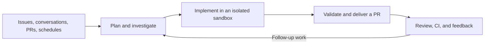

## 总结

Robin 是 LangChain 开源的软件工厂，目标不是“生成代码”，而是把工程工作变成**可重复、可运行的系统**。

- 主流程：调查仓库 → 在隔离 sandbox 实现 → 验证 → 交付 PR → review/CI/反馈 → 再回到下一轮。
- 能力覆盖 Build、Parallelize、Review、Investigate、Operate、Customize。
- 入口包括 dashboard、GitHub issues/PR 对话、Slack，以及 Linear 里的 mention/delegate。
- Deep Agents 提供规划、文件系统、shell、skills、subagent；LangGraph 提供持久执行和 thread 状态；Robin 补工程工具、集成、认证和 UI。
- 云端 coding 跑在每 thread 持久的 Linux sandbox 里；sandbox 失联不会被静默替换。
- 安全边界包括 GitHub App 权限、MCP kit、审批提示和最小权限；sandbox 能力强且有网络，必须按部署收紧。
- 项目仍在活跃开发，可能有 breaking changes；当前不接受 issue 和外部贡献。

## 原文逐段对照翻译

> **翻译说明：**以下按 README 顺序翻译全部章节；Mermaid 流程图保持原样。README 中的徽章和导航从略，正文、文档列表和许可证逐项翻译。

### 项目定位

Robin. An open-source software factory built on Deep Agents by LangChain.

Robin：一个由 LangChain 构建、基于 Deep Agents 的开源软件工厂。

Robin turns engineering work into a repeatable system: investigate a codebase, implement changes, validate them, and deliver a pull request. It also reviews pull requests, learns repository-specific review preferences, monitors CI, and responds to feedback. Built by LangChain, it is open source and deployable in your infrastructure.

Robin 把工程工作变成可重复的系统：调查代码库、实现改动、验证改动、交付 PR。它还会 review PR、学习仓库特定的 review 偏好、监控 CI，并响应反馈。它由 LangChain 构建，开源，可部署在你自己的基础设施里。

Under active development. Expect breaking changes and rough edges. We’re not accepting issues or external contributions at this time. You’re welcome to explore and fork the code, but correctness, stability, and compatibility are not guaranteed. If you really want to deploy it yourself, follow the installation guide. Deploying it as is requires Managed Deep Agents, which runs its agent; without it, we recommend forking and adapting the code to your own runtime.

项目仍在活跃开发中：预计会有 breaking changes 和粗糙边缘。目前不接受 issue 或外部贡献。欢迎阅读和 fork 代码，但不保证正确性、稳定性和兼容性。如果确实想自己部署，请按安装指南操作；按原样部署需要 Managed Deep Agents 来运行 agent，没有它的话，建议 fork 后适配到你自己的 runtime。

### Robin 做什么

> 流程：输入（issues、对话、PR、定时任务）→ 规划与调查 → 在隔离 sandbox 实现 → 验证并交付 PR → review/CI/反馈 → 后续工作回到规划。

Build: Investigate repositories, edit code, run focused validation, and open or update pull requests.

Build：调查仓库、修改代码、运行有针对性的验证、打开或更新 PR。

Parallelize: Use subagents for research and independent work.

Parallelize：用 subagents 做研究和独立工作。

Review: Run on-demand or opt-in automatic reviews, publish findings to GitHub, and learn from historical feedback.

Review：按需或选择加入自动 review，把发现发布到 GitHub，并从历史反馈中学习。

Investigate: Use read-only PR chat to understand a change without implementing changes.

Investigate：用只读的 PR 聊天理解一个改动，而不实际实现改动。

Operate: Schedule recurring tasks and monitor opted-in PRs with /baby-sit, diagnosing failures and rerunning only evidence-backed flaky jobs.

Operate：用 <code>/baby-sit</code> 调度周期性任务、监控选择加入的 PR，诊断失败，并且只重跑有证据支持的 flaky job。

Customize: Choose models, reasoning effort, instructions, skills, integrations, and sandbox providers.

Customize：选择模型、reasoning effort、指令、skills、集成和 sandbox provider。

Start and continue work from the dashboard, GitHub issues and PR conversations, or Slack. In Linear, mention or delegate an issue to the Robin app to open an agent session. Cloud coding follow-ups reuse the thread’s context and sandbox; independent threads can run in parallel.

可以从 dashboard、GitHub issues/PR 对话或 Slack 开始并继续工作。在 Linear 里，mention 或 delegate 一个 issue 给 Robin app，就能打开 agent session。云端 coding 的后续消息会复用该 thread 的上下文和 sandbox；独立 thread 可以并行运行。

### 如何工作

Deep Agents supplies planning, filesystem, shell, skills, and subagent primitives. LangGraph provides durable execution and thread state. Robin adds engineering tools, integrations, authorization, and user interfaces. The graph entrypoints are declared in langgraph.json, with an architecture inventory in AGENTS.md.

Deep Agents 提供规划、文件系统、shell、skills 和 subagent 原语；LangGraph 提供持久执行和 thread 状态；Robin 增加工程工具、集成、授权和用户界面。Graph 入口声明在 <code>langgraph.json</code>，架构清单在 <code>AGENTS.md</code>。

Cloud coding runs in persistent, per-thread Linux sandboxes with tooling supplied by global setup scripts and sandbox images. An unreachable coding sandbox is not silently replaced. LangSmith is the default sandbox and tracing provider; other providers and local execution are configurable. PR chat does not need a sandbox.

云端 coding 跑在每 thread 持久的 Linux sandbox 里，工具由全局 setup scripts 和 sandbox images 提供。无法连接的 coding sandbox 不会被静默替换。LangSmith 是默认的 sandbox 和 tracing provider；其他 provider 和本地执行都可以配置。PR 聊天不需要 sandbox。

### 控制与安全

GitHub access: Coding sandboxes normally receive installation-wide GitHub App access; selected workflows use narrower repository scopes. Repository bindings control integrations, not credentials or image preloads.

GitHub 访问：coding sandboxes 通常获得 installation 范围的 GitHub App 访问权限；部分 workflow 使用更窄的仓库范围。Repository binding 控制的是集成，不是凭据或镜像预加载。

Integrations: Runs get MCP tools from LangSmith Managed Tools kits: the owner's personal kit in private threads and Robin's bot kit otherwise. Add other servers to a kit in LangSmith.

集成：运行时会从 LangSmith Managed Tools kits 获取 MCP 工具——私有 thread 用 owner 的个人 kit，其他情况用 Robin 的 bot kit。可以在 LangSmith 里往 kit 添加其他 server。

Approvals: Workflow-file approval prompts guard detected Git pushes, not every possible shell or API write. Reviewers are instructed not to commit or push; PR chat excludes mutation tools.

审批：workflow-file 的审批提示保护的是检测到的 Git push，而不是所有可能的 shell 或 API 写操作。Reviewer 被要求不要 commit/push；PR 聊天不包含 mutation 工具。

Sandboxes have powerful tools and may have network access. Use least-privilege credentials, restrict repositories and integrations, and tailor approval policies to your deployment. Local execution does not provide cloud sandbox isolation.

Sandbox 里有强大的工具，也可能有网络访问。要使用最小权限凭据、限制仓库和集成范围，并按部署场景定制审批策略。本地执行不提供云端 sandbox 隔离。

### 文档

Robin rollout checklist — External integration updates, desktop upgrade checks, and compatibility boundaries.

Robin rollout checklist——外部集成更新、桌面端升级检查和兼容性边界。

Customization guide — Models, sandboxes, tools, skills, prompts, triggers, and middleware.

定制指南——模型、sandboxes、工具、skills、prompts、triggers 和 middleware。

Plugin guide — Build web apps: sandboxed single-file plugins people add to their sidebar.

插件指南——构建 Web 应用：把 sandboxed 单文件插件加到侧边栏。

Defaults, routing, and sandbox images — Routing, settings, images, and access.

默认配置、路由和 sandbox images——路由、设置、镜像和访问控制。

Human review in Slack — Review requests in a repository's Slack channel, merged once reviewers approve.

Slack 里的人工 review——在仓库的 Slack 频道里发 review 请求，reviewer 批准后合并。

Expedited Slack review — Human approval for small pull requests.

加急 Slack review——为小型 PR 提供人工批准。

Backend API documentation — Live API docs and the generated OpenAPI schema.

后端 API 文档——在线 API 文档和生成的 OpenAPI schema。

Original announcement — Background on the internal coding-agent framework.

原始发布公告——内部 coding-agent 框架的背景介绍。

Security policy — Report security concerns privately.

安全策略——私下报告安全问题。

### 许可证

Robin is licensed under the MIT License.

Robin 使用 MIT License。

That license covers Robin's own code only. It does not cover anything under vendor/, which is not licensed by this repository at all.

该许可证只覆盖 Robin 自己的代码，不覆盖 <code>vendor/</code> 下的任何内容；该目录不由本仓库授权。

## 学习者视角

### 关键收获

1. **软件工厂是“可重复系统”，不是“更长的 prompt”。** 调查、实现、验证、交付、review、反馈被拆成可运行阶段。
2. **Agent 基础设施要分层。** Deep Agents 管规划/文件/shell/skills/subagent，LangGraph 管持久执行，Robin 管工程工具和 UI。
3. **Thread 是一等状态。** 每个 thread 有持久 sandbox，后续消息复用上下文；独立 thread 并行。
4. **安全边界要显式。** GitHub App 范围、MCP kit、审批提示、PR chat 只读，都是防止 agent 越界的机制。
5. **项目仍在早期。** 不接受 issue/贡献、可能有 breaking changes，说明它更适合阅读和 fork，而不是直接生产部署。

### 放回课程里看

这篇是 Week 8 的“开源软件工厂”代表：它把 Week 9 的 Software Factory 思路做成可自托管代码。和 [OpenInspect](w9-openinspect-background-agents.html) 相比，Robin 更强调 Deep Agents/LangGraph 的编排和 thread 持久化；和 [Warp Factory](w9-warp-factory-issue-to-pr.html) 相比，Robin 更强调 review、CI 监控和反馈闭环。

### 一个反直觉点

很多人把“开源软件工厂”理解成一套 prompt 模板。Robin 的重点其实是**运行时和状态**：thread、sandbox、durable execution、审批和权限边界。没有这些，agent 只能做一次性 demo，无法成为持续运行的工厂。

## 拓展

### 思考题

1. 为什么 PR chat 不需要 sandbox，而 coding 需要持久 sandbox？
2. 如果 sandbox 失联不被静默替换，对用户体验和可靠性有什么影响？
3. GitHub App installation 级权限和仓库级权限，应该如何取舍？
4. 为什么 workflow-file 审批只保护 Git push，而不是所有 shell/API 写操作？这足够吗？

### 练习

为一个开源软件工厂画出最小架构：

- 哪些能力由 agent framework 提供；
- 哪些由 workflow/runtime 提供；
- 哪些由你自己的工程工具提供；
- thread 和 sandbox 的生命周期；
- GitHub/MCP/审批的权限边界；
- 哪些操作必须只读，哪些必须人工批准。

### 接着读

- [Stripe Minions：自建 harness 与 CI 反馈](w8-stripe-minions.html)
- [Ramp Inspect：sandbox 与多人协作](w8-ramp-background-agent.html)
- [Software Factory：10 天实验记录](w9-software-factory.html)
